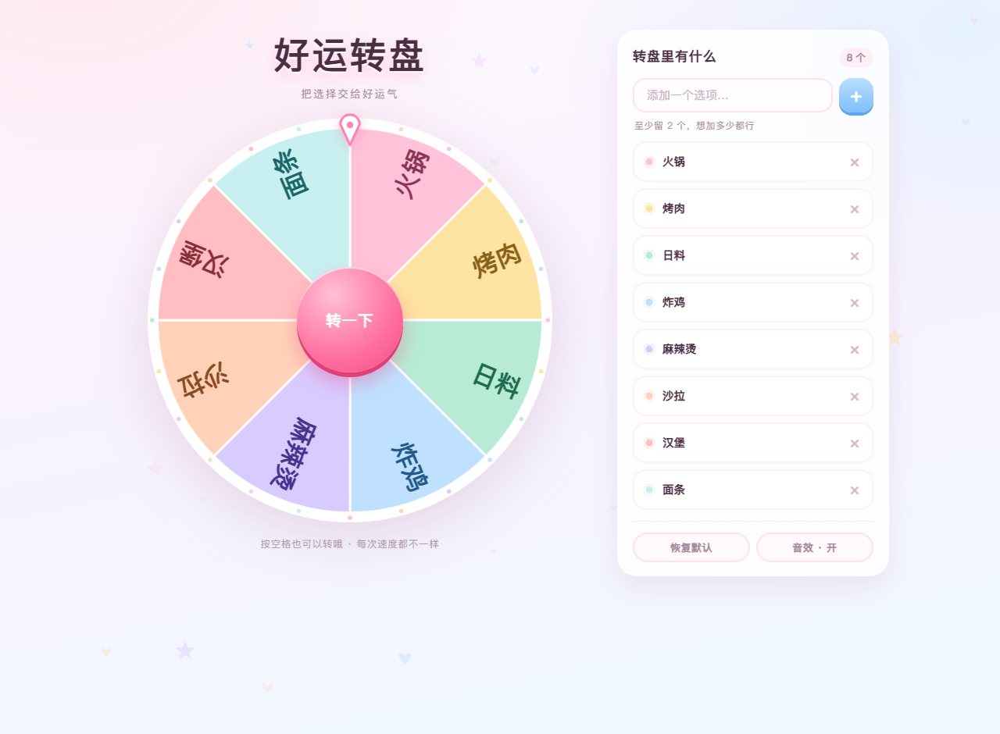

# 好运转盘 · Lucky Wheel

一个送人的小转盘：加加减减想选的东西，按一下，把决定权交给运气。

零依赖、零构建、零网络请求——双击就能玩，断网也能玩。同一份网页源码出两个版本：浏览器打开，或者装成安卓 App。



> 扇区数量不固定：2 个就是两半，24 个就是二十四格，字号自动跟着缩。见 [`web/preview-many.png`](web/preview-many.png)。

---

## 一、两个版本，一份源码

| 版本 | 入口 | 形态 | 怎么跑 |
|---|---|---|---|
| 网页版 | [`web/index.html`](web/index.html) | 纯 HTML + CSS + Canvas，零依赖零构建 | 双击打开 |
| 安卓版 | [`android/`](android/) | WebView 壳，单个 APK，**零权限**（连 INTERNET 都不申请） | `bash android/tools/build-apk.sh` |

安卓版**不复制**网页代码：每次构建从 `../web` 同步进 `assets/www`，改样式只改一份。

---

## 二、目录结构

```
lucky-wheel/
├─ web/                      网页版（可独立运行，也可打包发给别人）
│  ├─ index.html             页面骨架，内容全靠 JS 填
│  ├─ assets/styles/         base.css 主题变量 / wheel.css 转盘 / panel.css 面板
│  ├─ src/
│  │  ├─ config.js           ★ 所有可调参数与配色集中在这
│  │  ├─ store.js            单一数据源：增删 + 持久化 + 变更广播
│  │  ├─ wheel.js            ★ 转盘渲染 + 旋转引擎（落点算法是纯函数）
│  │  ├─ particles.js        背景飘落小心心 + 中奖彩纸（两块独立画布）
│  │  ├─ sfx.js              Web Audio 现场合成音效，不加载音频文件
│  │  ├─ ui.js               面板交互：列表、添加、删除、弹窗、快捷键
│  │  └─ main.js             装配层
│  └─ test/selftest.js       落点数学 / 缓动曲线自检
│
└─ android/                  安卓壳工程
   ├─ app/src/main/java/…/   MainActivity / Bridge / AssetClient
   ├─ app/src/main/res/      图标、启动画面、主题
   ├─ tools/build-apk.sh     ★ 手工打包脚本，不需要 Gradle / Android Studio
   └─ doc/icon.png
```

依赖方向单向，两边不互相认识：

```
util ← config ← store
        ↓         ↓
      wheel ← ui ← main
```

`wheel.js` 不碰 DOM 按钮，`store.js` 不碰 Canvas，只通过 `setItems()` / `on('start'|'tick'|'end')` 打交道。想换一套 UI 或换一种画法，另一边不用动。

---

## 三、跑起来

**网页版**：双击 `web/index.html`。发给别人就整个 `web/` 打包过去，相对路径，解压就能开。手机浏览器打开也有响应式布局。

**安卓版**：

```bash
# 需要 JDK 17+ 和 Android SDK 的 build-tools 34.0.0 + platform android-34
export ANDROID_HOME=/path/to/android-sdk
bash android/tools/build-apk.sh
# 产物：android/build/lucky-wheel.apk
```

minSdk 26 / targetSdk 34，包名 `com.littlecodesauce.luckywheel`。

> **签名说明**：本仓库**不含**签名证书 `keystore/lucky-wheel.keystore`（私钥不进公开仓库）。首次构建会自动生成一把新的；如果你手机上已经装过旧 APK，想让新包覆盖安装，就把原来的 keystore 放回 `android/keystore/` 再构建，否则系统会拒绝覆盖。

---

## 四、想改什么，改哪里

全部参数集中在 `web/src/config.js`：

| 想改什么 | 改哪里 |
|---|---|
| 扇区配色 | `palette`（同时改 `assets/styles/base.css` 的 `:root` 会更一致） |
| 默认选项 | `defaults` |
| 扇区数量上限 / 下限 | `maxItems`（默认 24，软上限）/ `minItems`（默认 2） |
| 转得更久 / 更疯狂 | `spin.minDuration`、`spin.maxDuration` / `spin.minTurns`、`spin.maxTurns` |
| 停下时更「黏」 | `spin.minPower`、`spin.maxPower`（指数越小尾段越拖） |
| 落点更随机 | `spin.jitterRatio`（0 = 永远停在扇区正中） |
| 音效音量 / 开场时长 | `audio.volume` / `boot.minDuration` |
| 标题文字 / 中奖表情 | `ui.js` → `animateTitle()` / `WIN_EMOJI` |

---

## 五、三个值得一提的设计

**转速不是一个固定值。** 整圈数（4~9）、时长（3.8~6.4s）、缓动指数（3.1~4.9）各自独立随机，所以同样的总时长会出现「猛拧一把慢慢停」和「温温柔柔滑到停」两种完全不同的手感。

**每个选项的中奖概率严格相等。** 先随机选中扇区，再在扇区内随机抖动位置，反解出所需旋转角——不是「转多少圈碰运气」。

**落点算法能脱离浏览器测。** 抽成了纯函数 `CuteWheel.wheelMath.targetDelta()`：

```bash
node web/test/selftest.js
```

跑 20 万次随机采样，验证指针最终确实落在目标扇区内，以及缓动曲线全程单调、首尾精确为 0 和 1。

---

## 六、数据与边界

- 选项存浏览器 `localStorage`（键 `cute-wheel.items.v1`），读回来会做清洗：类型不对、空串、超长、条目数越界的都丢掉，洗不干净就退回默认列表。禁用存储时降级为内存态，不会白屏。
- 单个选项最长 14 字符（`maxLabelLength`），超出截断补省略号，避免一条长文本把扇区撑变形。
- 转盘上的字一半正一半反——字固定在盘面上，盘转字跟着转，是物理不是 bug。沿半径排布是经典转盘的通行做法。
- 空格键转动、Esc 关弹窗，`prefers-reduced-motion` 下自动关掉背景飘落并跳过逐字动画。

---

## 七、这仓库怎么来的

一个人的 vibe coding 产物：一段自然语言需求（「写个可爱风转盘，能加删内容，转速要随机，打开有过渡，要可维护」）交由 AI 全程生成，产出网页版 + 安卓壳两套东西。

对应的完整会话日志（含每一步工具调用与中间截图）另存为 dsh session 归档，不在本仓库内。
