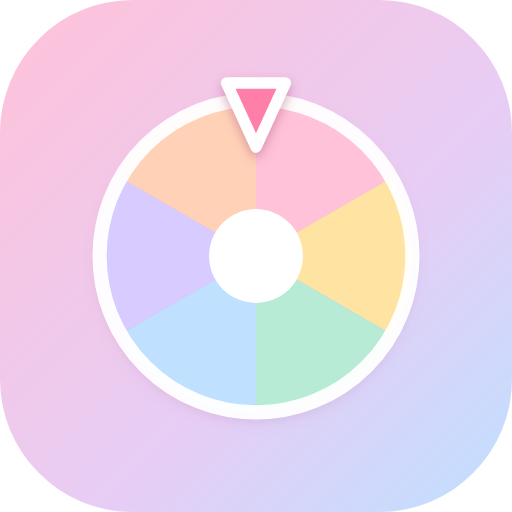

# 好运转盘 · Android 版

把网页版的那个转盘包成一个真正的安卓 App：一个 apk，装上就能用，
不联网、不要权限、没有广告 SDK。



> 单个 APK，46 KB，**零权限**（连 INTERNET 都不申请）、零第三方依赖、
> 断网可玩。minSdk 26 / targetSdk 34。

---

## 一、装上它

`build/lucky-wheel.apk` 传到手机上点开安装。

第一次装会提示"来自未知来源"——因为这是自己签的包，不是从应用商店下的，
允许一次就好。

> 签名证书是构建时自动生成的 `keystore/lucky-wheel.keystore`。
> **这个文件别删**：以后出更新包要用同一把钥匙签，否则手机上会装不上覆盖安装，
> 只能先卸载旧的。想换成自己的证书就替换这个文件。

---

## 二、打开之后会看到什么

点图标 → **系统启动画面显示应用图标**（系统级，秒开，没有白屏闪烁）→
图标**放大并淡出** → 转盘浮现、标题逐字弹出。

这套过渡是两层接力的：

1. `windowBackground` 指向 `splash_window.xml`，系统在 Activity 建好之前就先画出
   粉色底 + 图标，所以点下去不会看到白屏；
2. Activity 里再盖一层 `ic_splash`，等网页通过 `NativeShell.onReady()` 报告
   "首帧已经画好了"，这层图标放大 1.28 倍并淡出，把画面交给转盘。

网页那边检测到 `window.NativeShell` 存在，就会把开场等待从 1.1 秒压到 0.2 秒——
不然两层过渡叠起来会显得拖沓。

万一网页脚本出错没回调，原生还有 4.5 秒兜底，不会把人卡在图标上。

---

## 三、目录结构

```
lucky-wheel-android/
├─ app/src/main/
│  ├─ AndroidManifest.xml            清单：零权限、竖屏、launchMode 默认
│  ├─ java/com/littlecodesauce/luckywheel/
│  │  └─ MainActivity.java           全部原生逻辑（约 250 行，没有第二个类）
│  ├─ res/
│  │  ├─ drawable/
│  │  │  ├─ ic_splash.xml            启动图标（渐变圆角底 + 转盘），矢量
│  │  │  ├─ ic_launcher_foreground.xml  自适应图标前景（转盘 + 指针）
│  │  │  ├─ ic_launcher_background.xml  自适应图标背景（渐变）
│  │  │  └─ splash_window.xml        windowBackground：纯色底 + 居中图标
│  │  ├─ mipmap-anydpi-v26/          自适应图标（API 26+，矢量，任意分辨率都清晰）
│  │  └─ values/                     主题、颜色、应用名
│  └─ assets/                        构建时自动同步，不用手改
├─ tools/
│  ├─ build-apk.sh                   手工打包脚本（不需要 Gradle）
│  ├─ PackAssets.java                打 assets + classes.dex（保证条目名用正斜杠）
│  ├─ CheckApk.java                  产物结构自检
│  └─ ListEntries.java               列出 zip 条目名，排查打包问题用
├─ app/build.gradle.kts              Android Studio 直接打开也能构建
└─ build/lucky-wheel.apk             产物
```

---

## 四、网页代码只有一份

App 里跑的网页**不是复制品**。`tools/build-apk.sh` 每次构建都会从
`../web` 同步到 `assets/www`，Gradle 里也挂了一个 `syncWebAssets` 任务。

所以改转盘内容的姿势是：

```
改 ../web 里的 html/css/js  →  重新打包  →  装上
```

永远不用在两个地方各改一遍。

---

## 五、怎么重新打包

### 用脚本（不需要 Gradle）

```bash
bash tools/build-apk.sh
```

需要的东西：

- **JDK 17+**（`javac`、`keytool`）
- **Android SDK build-tools 34.0.0**（`aapt2`、`d8`、`zipalign`、`apksigner`）
- **Android SDK platform 34**（`android.jar`）

脚本跑完，产物在 `build/lucky-wheel.apk`。

SDK 路径默认读 `$ANDROID_HOME`，没有就用 `/d/Tools/android-sdk`，
可以用 `ANDROID_HOME=... bash tools/build-apk.sh` 覆盖。

### 用 Android Studio

直接打开 `lucky-wheel-android` 目录，等 Gradle 同步完，点 Run 就行。
工程里已经有完整的 Gradle 配置（AGP 8.5.2 / Gradle 8.7 / minSdk 26 / targetSdk 34）。

---

## 六、构建时踩到的坑（写下来省得下次再踩）

**`aapt2 link` 要求清单里有 `package` 属性。**
AGP 会用 `namespace` 自动注入，手工调 aapt2 不会，报
`<manifest> must have a 'package' attribute`。所以清单里显式写了 `package`，
和 `build.gradle.kts` 里的 `namespace` 保持一致，两边都不冲突。

**build-tools 34 自带的 d8（8.2.2）处理不了带内部类的 class。**
表现是构建到 dex 那一步抛 `NullPointerException: Cannot invoke "String.length()"`，
origin 指向某个 `MainActivity$Xxx.class`。换成 target 17、加 `--release`、
去掉匿名类都没用——只要类里有 `InnerClasses` 属性、且父类来自 `android.jar`，
就会踩到。最后的解法是**把所有内部类和匿名类都提到顶层**（`Bridge`、`AssetClient`
各占一个文件，剩下的回调改用 lambda）。顺带代码也更平了。

**javac 21 生成的 class 默认是 major 65，d8 直接拒收**
（`Unsupported class file major version 65`）。所以 `javac` 显式加了
`-source 8 -target 8`，字节码降到 52.0。

**`WebSettings.setForceDarkAllowed` 在 API 34 的 `android.jar` 里已经没了**
（33 起换成了 `setAlgorithmicDarkeningAllowed`）。而 targetSdk 34 下 WebView 的
算法化暗黑本来默认就是关的，这行直接删掉即可，不用写反射。

**原生程序（javac / d8）的路径参数会被 msys 转换，但 `@sources.txt` 里的内容不会。**
所以构建脚本里 javac 那一步先 `cd` 到项目根目录，全部用相对路径，
不然会看到 `找不到文件: \d\watt2\...`（盘符丢了）。

**最坑的一条：Windows 上打出来的 APK，assets 条目名是反斜杠。**

`aapt2 link -A assets` 在 Windows 上会把目录路径原样写进 zip 条目名，
于是 APK 里躺着的是 `assets/www\index.html` 而不是 `assets/www/index.html`。
PowerShell 的 `ZipArchive.Open(path, 'Update')` 重写 zip 时也有同样毛病。

结果是：**APK 能装、能启动、图标正常、启动动画正常，然后网页一片 404。**
因为 Android 的 `AssetManager` 只认正斜杠，一个文件都读不到，
`shouldInterceptRequest` 里 `getAssets().open()` 全部抛 IOException。

最终方案：**aapt2 不碰 assets**，交给 `tools/PackAssets.java`——
用 `java.util.zip` 自己遍历目录、自己用 `/` 拼路径、顺便把 `classes.dex` 一起加进去。
它同时保留每个原条目的压缩方式，`resources.arsc` 依然是 STORED
（targetSdk 30+ 的包如果压了它，安装会失败）。

打包完可以用 `java tools/CheckApk.java build/lucky-wheel.apk` 验一遍结构：
条目名有没有反斜杠、`resources.arsc` 是不是 STORED、`classes.dex` 在不在。

---

## 七、几个刻意的选择

**零第三方依赖。**
没有 AppCompat、没有 AndroidX、没有 Kotlin 标准库。整个 App 只有一个 Activity 类，
依赖只有框架自带的 `android.jar`。好处很实在：包体小、启动快、不需要联网下载 AAR，
而且五年后回头看，不会因为某个库停止维护而打不开。

代价是所有东西都得自己写——比如把 `assets/www` 挂成一个 https origin，
本来 `androidx.webkit` 的 `WebViewAssetLoader` 三行就搞定，这里是手写的
`shouldInterceptRequest`。但也就三十行。

**为什么不直接用 `file:///android_asset/`。**
`file://` 协议下 WebView 的 `localStorage` 行为在不同版本上不一致，转盘的选项要
持久化，赌不起。挂到 `https://appassets.androidplatform.net` 之后，网页拿到的是
一个正常的 origin，storage 行为和浏览器完全一致。

**为什么全程不需要 INTERNET 权限。**
所有请求都被 `shouldInterceptRequest` 拦下来从 assets 读了，一个字节都不出网。
清单里干脆不申请联网权限——用户装的时候看到"无权限"会更安心。

**为什么锁竖屏。**
转盘是正方形的，面板在下面，横过来会很难看。`android:screenOrientation="portrait"`。

**返回键。**
先问网页 `window.LuckyWheelApp.dismissOverlay()`——结果弹窗开着就关弹窗，
没开才退出应用。不会出现"按返回直接把整个 App 干掉"的突兀感。

---

## 八、已知边界

- `minSdk 26`（Android 8.0）。再往下就得给图标补一套 PNG，而自适应图标本身
  就是矢量，为此多维护五张图不划算。
- 应用锁竖屏，平板横屏体验未做适配。
- 签名用的是构建时生成的自签证书。想上架应用商店需要换成正式签名，
  并且要处理 `versionCode` 递增（改 `AndroidManifest.xml` 里的 `android:versionCode`）。
