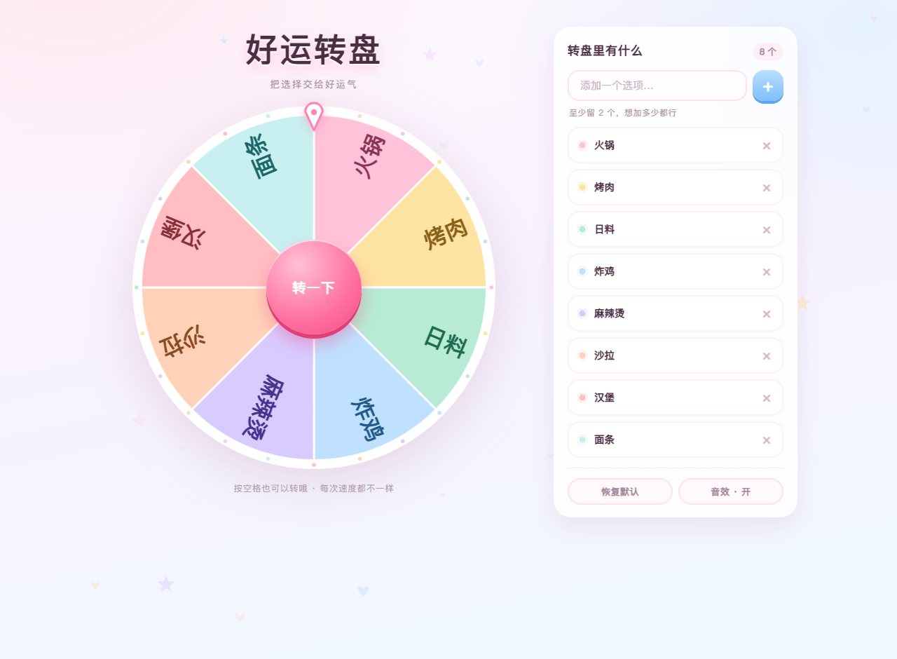

# 好运转盘 · Lucky Wheel

一个送人的小转盘：加加减减想选的东西，按一下，把决定权交给运气。
零依赖、零构建、零网络请求——双击 `index.html` 就能玩，断网也能玩。



> 扇区数量不固定：2 个就是两半，24 个就是二十四格，字号自动跟着缩。
> 见 `preview-many.png`。

---

## 一、怎么打开

双击 `index.html`。

- 想发给别人，整个 `lucky-wheel` 文件夹打包发过去即可（相对路径，解压就能开）。
- 如果哪天想挂到本地服务器上，`npx serve .` 也行，但不是必须的——没有用 ES Module，也就没有 `file://` 的跨域限制。
- 手机浏览器直接打开 `index.html` 也有响应式布局（窄屏转盘与面板上下排布）。

---

## 二、目录结构

```
lucky-wheel/
├─ index.html                 页面骨架（只有一个空壳，内容全靠 JS 填）
├─ assets/styles/
│  ├─ base.css                主题变量、全局重置、启动过渡、toast、通用按钮
│  ├─ wheel.css               舞台、标题、转盘容器、指针、中心按钮
│  └─ panel.css               右侧面板、选项列表、结果弹窗
├─ src/
│  ├─ util.js                 无依赖工具（数学、随机、存储、唯一 id）
│  ├─ config.js               ★ 所有可调参数与配色集中在这里
│  ├─ store.js                单一数据源：增删 + 持久化 + 变更广播
│  ├─ sfx.js                  Web Audio 现场合成音效（不加载任何音频文件）
│  ├─ particles.js            背景飘落小心心 + 中奖彩纸（两块独立画布）
│  ├─ wheel.js                ★ 转盘渲染 + 旋转引擎（含落点纯函数）
│  ├─ ui.js                   面板交互：列表、添加、删除、弹窗、快捷键
│  └─ main.js                 装配层：把上面这些拼起来，收尾启动过渡
├─ test/selftest.js           落点数学 / 缓动曲线自检（node 直接跑）
├─ preview.png                桌面端预览（默认 8 个选项）
├─ preview-many.png           加到 24 个时的样子（字号自动缩）
└─ preview-mobile.png         移动端预览
```

依赖方向是单向的：

```
util ← config ← store
        ↓         ↓
      wheel ← ui ← main
```

`wheel.js` 不认识 DOM 按钮，`store.js` 不认识 Canvas，两边都只通过
`setItems()` / `on('start'|'tick'|'end')` 打交道。想换一套 UI 或换一种画法，
另一边不用动。

---

## 三、想改东西，去哪儿改

| 想改什么 | 改哪里 |
|---|---|
| 扇区配色 | `src/config.js` → `palette`（同时改 `assets/styles/base.css` 的 `:root` 会更一致） |
| 默认选项 | `src/config.js` → `defaults` |
| 扇区数量上限 | `src/config.js` → `maxItems`（默认 24，只是软上限，字号会自动缩） |
| 最少几个 | `src/config.js` → `minItems`（默认 2） |
| 转得更久一点 | `src/config.js` → `spin.minDuration` / `maxDuration` |
| 转得更疯狂一点 | `src/config.js` → `spin.minTurns` / `maxTurns` |
| 停下时更"黏"一点 | `src/config.js` → `spin.minPower` / `maxPower`（指数越小尾段越拖） |
| 落点更随机 | `src/config.js` → `spin.jitterRatio`（0 = 永远停在扇区正中） |
| 音效音量 | `src/config.js` → `audio.volume` |
| 开场停留时长 | `src/config.js` → `boot.minDuration` |
| 标题文字 | `src/ui.js` → `animateTitle('好运转盘')` |
| 中奖表情 | `src/ui.js` → `WIN_EMOJI` |
| 弹窗提示语 | `index.html` → `#dialogTitle` 的文案 |

---

## 四、扇区数量是动态的

画多少个扇区，完全由列表里有多少条决定——2 个就是两半，24 个就是二十四格，
中间不经过任何"固定 12 格"的模板。

字号自动跟随两条约束取小值：

1. **盘面尺寸**：大盘字大，小盘字小；
2. **扇区中部弧宽**：扇区越多越窄，字高不能超过弧宽，否则相邻扇区的字会压在一起。

所以刚加进去两三条时字很大、很清爽，加到二十几条时字会自动缩小到刚好塞得下，
不需要你去调任何参数。24 条的实际效果见 `preview-many.png`。

`maxItems` 只是个"再多人眼就分不清了"的软上限，想突破就改它——
字号会继续跟着缩，不会溢出或重叠。

---

## 五、转速为什么每次都不一样

不是简单地换个圈数，而是三个旋钮各自随机：

1. **整圈数** `minTurns ~ maxTurns`（4 ~ 9 圈）——决定"转了多少"；
2. **时长** `minDuration ~ maxDuration`（3.8 ~ 6.4 秒）——决定"转得多快"；
3. **缓动指数** `minPower ~ maxPower`（3.1 ~ 4.9）——决定"起步多猛、收尾多软"。

圈数和时长各自随机，平均角速度就不是一个固定值；
缓动指数再随机一次，同样的总时长也会出现"猛拧一把慢慢停"和
"温温柔柔滑到停"两种完全不同的手感。

落点怎么算：先随机选中一个扇区，再在扇区里随机抖一下位置，
反解出需要的旋转角。所以**每个选项的中奖概率严格相等**，
只是停下来时不会每次都怼在扇区正中间。

这套计算被抽成了纯函数 `CuteWheel.wheelMath.targetDelta()`，
不碰 DOM，所以能脱离浏览器直接测：

```bash
node test/selftest.js
```

它会跑 20 万次随机采样，验证"最终指针确实落在目标扇区内"，
以及缓动曲线在整段参数区间内单调递增、首尾精确为 0 和 1。

---

## 六、数据存在哪里

浏览器 `localStorage`，键名 `cute-wheel.items.v1`（音效开关是 `cute-wheel.sound.v1`）。

- 存的是 `[{id, label}]`，读回来时会做一次清洗：类型不对、空串、
  超长、条目数越界的数据都会被丢掉，洗不干净就退回默认列表。
- 隐私模式 / 浏览器禁用存储时会自动降级成内存态：这次会话照常玩，关掉就没了，
  不会因为存不下而白屏。
- 想清空重来：面板上「恢复默认」，或者浏览器里删掉那条 localStorage。

---

## 七、几个刻意的取舍

**文字为什么是一半正一半反？**
转盘上的字是固定在盘面上的，盘转了字就会跟着转——这是物理，不是 bug。
沿半径排布是所有经典转盘的通行做法（Wheel of Fortune 也是），
好处是每个扇区里的字都能塞满整个扇形，坏处就是总有一半在"倒着看"。
试过改成水平排布，扇区一窄就互相压字，反而更丑，所以保留了径向。

**为什么用 Canvas 而不是 SVG / DOM？**
转起来是每帧重画。12 个扇区 + 24 个装饰点，Canvas 一次 `fillText` 就够，
DOM 方案在旋转时会有上百个元素参与合成，手机上容易掉帧。
文字截断的结果还做了缓存，旋转时不会每帧重复 `measureText`。

**为什么不用构建工具？**
送人的小东西，拿到手双击就能开、改一行就生效，比"先装个 node_modules"重要得多。
真要上构建，把 `<script>` 换成 `import` 也就十分钟的事——模块边界已经划好了。

**无障碍这块做了什么？**
空格键转动、Esc 关弹窗、弹窗打开后焦点落在按钮上、
`prefers-reduced-motion` 下自动关掉背景飘落并跳过逐字动画。

---

## 八、已知边界

- 默认软上限 24 个。超过之后扇区只剩十几度，字虽然还是会按弧宽缩小，
  但已经小于舒适阅读尺寸了，所以没往上放。想突破就改 `maxItems`，
  字号逻辑不需要动。
- 选项名超过 14 个字符会被截断并补省略号（`maxLabelLength`），
  这是为了避免一两条长文本把整块扇区撑变形。
- 浏览器标签页切到后台时会暂停 `requestAnimationFrame`，转盘会"卡"在半路，
  切回来继续转——所有基于 rAF 的动画都这样，属于正常现象。
- 单个选项最长 14 个字符（`maxLabelLength`），超出的部分会被截断而不是撑破版面。
